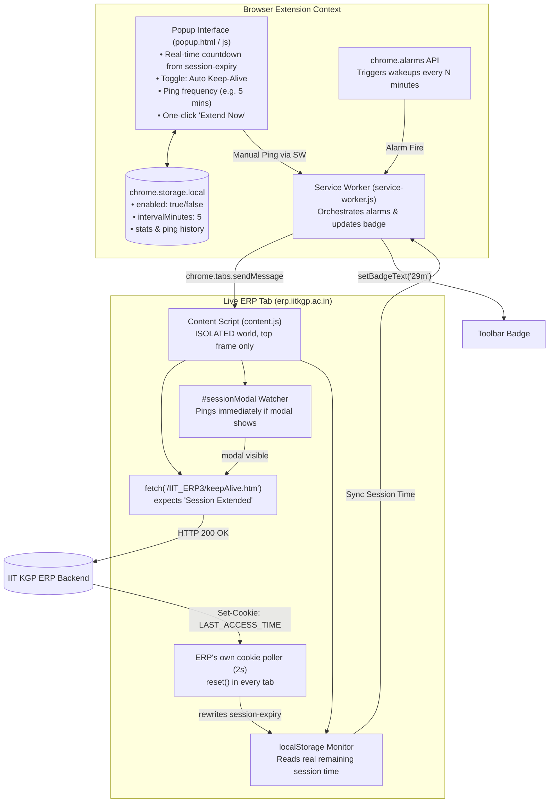

# ERP Session Active — Chrome Extension Implementation Plan

## 1. Executive Summary & Live Inspection Insights

We connected to and analyzed the live ERP session running in Brave via Chrome DevTools Protocol (`ADE40DEF32F987D27E1C7FB587B8B44B` — *IIT Kharagpur ERP*).

### Verified System Ground Truth:
- **ERP URL Structure**: `https://erp.iitkgp.ac.in/IIT_ERP3/showmenu.htm`
- **Native Session Manager**: Loaded via `https://erp.iitkgp.ac.in/IIT_ERP3/js/session_timeout.js`
- **Init**: An inline script in `showmenu.htm` calls `SessionManager.init({ timeoutSeconds: 1800, keepAliveUrl: 'https://erp.iitkgp.ac.in/IIT_ERP3/keepAlive.htm', logoutUrl: 'https://erp.iitkgp.ac.in/IIT_ERP3/logout.htm' })`. The defaults inside the JS file (`/keepAlive.htm`, `/logout.htm`) are overridden and are **not** the real URLs.
- **Session Lifespan (`timeoutSeconds`)**: `1800` seconds (30 minutes).
- **Warning Window (`warningOffset`)**: `10` minutes before expiry, i.e. 20 minutes after the last reset. The page has **no mouse/keyboard activity listeners**. The timer resets only on page load, a `LAST_ACCESS_TIME` cookie change, or a `session-event`/`session-expiry` storage event from another tab. Working inside one page (such as filling a long form) does **not** keep the session alive.
- **Session Expiry Trigger**: `logoutTimer` fires at `remaining - 5s` (`safetyBuffer`), or the modal countdown (595s) reaches 0. Either way `logout()` broadcasts `LOGOUT` (which logs out **every** ERP tab), removes `session-expiry`, and redirects to `logoutUrl`.
- **Official Heartbeat Endpoint**: `https://erp.iitkgp.ac.in/IIT_ERP3/keepAlive.htm`. Verified response: `200`, `text/plain`, body `Session Extended`, header `Set-Cookie: LAST_ACCESS_TIME=<epoch ms>; Path=/`.
- **State Synchronization Architecture**:
  - `localStorage['session-expiry']`: Unix epoch **milliseconds** of the impending expiry.
  - `localStorage['session-event']`: `{action, time}` JSON that coordinates `RESET_SESSION`, `EXTEND_SESSION`, `SHOW_WARNING`, and `LOGOUT` across tabs.
  - `Cookie: LAST_ACCESS_TIME`: Not HttpOnly, so JS can read it. `startCookiePolling()` checks it every 2000ms and calls `reset()` when the value increases. `keepAlive.htm` is verified to set it. Other module requests (Academic, TrainingPlacementSSO) *may* set it as well, since the cookie path is `/`, but that is **unverified**.
- **Page Layout**: `showmenu.htm` is a shell. Modules load inside `<iframe id="myframe">`, which can point at other same-origin apps (for example `/TrainingPlacementSSO/TPStudent.jsp`) that have their own session cookies (`JSID_Academic`, `JSID_TrainingPlacementSSO`). `SessionManager` exists only in the top frame.
- **Tested & Verified Live (2026-10-28)**: `fetch('/IIT_ERP3/keepAlive.htm')` updated `LAST_ACCESS_TIME`, and within one poll cycle the page's `session-expiry` reset to **29.96 min** remaining.

---

## 2. Extension Architecture



---

## 3. Core Capabilities & Design Decisions

### 3.1 Heartbeat Strategy (simplified: no MAIN-world bridge needed)
1. **Primary: Authenticated HTTP Ping** from the content script: `fetch('/IIT_ERP3/keepAlive.htm', { credentials: 'include' })`. This refreshes the server session and sets `LAST_ACCESS_TIME`. Every ERP tab's cookie poller then calls `reset()` within about 2s, which hides the modal, stops the title blink, and rewrites `session-expiry`. This was verified live, and it does everything `SessionManager.extend()` does (`extend()` is just `$.get(keepAliveUrl)` + `reset()`).
   - **Success check**: treat the ping as OK only if `status === 200 && !redirected && body.includes('Session Extended')`. Anything else (such as a redirect to the login page) means the server session is already gone. Report `EXPIRED` and stop pinging; do not keep "succeeding".
2. **Modal fallback**: Use a `MutationObserver` on `#sessionModal` (Bootstrap adds the `in` class and `display:block`). When it becomes visible, send an immediate ping. The cookie poller dismisses the modal on its own, so there is no need to click "Continue" or force-hide it. Force-hiding would also fight the page's `hide.bs.modal` `preventDefault` guard.
3. ~~`inject.js` / MAIN-world `SessionManager.extend()`~~: **dropped**. It adds a second code path with no benefit. If it is ever needed, use a manifest content script with `"world": "MAIN"` rather than an injected `<script>` tag.

**Known limits:**
- If the laptop sleeps past expiry, the page's `logoutTimer` (a `setTimeout`) fires right after resume, before any alarm can run. The extension cannot prevent this. It can only show "expired" in the badge.
- Hidden tabs are throttled (intensive timer throttling caps the 2s cookie poll at about once per minute). That is still far inside the 20-minute warning window, and `visibilitychange` re-syncs anyway.
- `IIT_ERP3/keepAlive.htm` keeps the **IIT_ERP3** session alive. Whether sub-app sessions (`JSID_Academic`, `JSID_TrainingPlacementSSO`) are kept alive by it, or time out on their own server-side schedule, is **unverified**. Test this by leaving a module open in `#myframe` for more than 30 min with only keepAlive pings running.

### 3.2 Real-Time Session Countdown in Extension Icon & Popup
- Because `localStorage['session-expiry']` is accessible on the domain, the content script reports the exact remaining minutes to the background service worker.
- The content script runs in the ISOLATED world, but it shares the page origin's `localStorage`, so it can read `session-expiry` directly. It can also listen for the `storage` event on `session-expiry` to push updates when another tab resets the timer.
- The extension badge displays the remaining minutes (e.g. `29m`, `25m`) and turns amber/red if it falls below 10 minutes. With pinging enabled this should only happen if pings are failing, so amber/red is effectively an error indicator.

### 3.3 Zero Redundant Pings
- The service worker sends `PING_KEEPALIVE` to **one** ERP tab per alarm. Every other tab picks up the cookie change through its own poller. No `BroadcastChannel` or lead-tab election is needed.

---

## 4. File Structure

```text
erp-sessionActive/
├── manifest.json
├── plan.md
├── README.md
├── icons/
│   ├── icon-16.png
│   ├── icon-48.png
│   └── icon-128.png
├── background/
│   └── service-worker.js
├── content/
│   ├── content.js      # ISOLATED: ping, expiry reporting, modal watcher, guard handler
│   └── guard.js        # MAIN, document_start: logout guard (see §7)
└── popup/
    ├── popup.html
    ├── popup.css
    └── popup.js
```

---

## 5. Detailed Component Specifications

### 5.1 `manifest.json`
- `manifest_version: 3`
- `name: "ERP Session Keeper (IIT KGP)"`
- `version: "1.0.0"`
- `permissions`:
  - `"storage"` (save preferences and history)
  - `"alarms"` (guaranteed periodic background execution)
  - (`"tabs"` is not needed: `chrome.tabs.query({url})` and `sendMessage` work with the host permission below)
- `host_permissions`:
  - `"https://erp.iitkgp.ac.in/*"` (only this; `*://*.iitkgp.ac.in/*` is unnecessarily broad)
- `content_scripts`:
  - `matches: ["https://erp.iitkgp.ac.in/IIT_ERP3/*"]`, `js: ["content/content.js"]`, `run_at: "document_idle"`, `all_frames: false` (`SessionManager`/`#sessionModal` live only in the top `showmenu.htm` frame, and module iframes must not ping on their own)
- `action`:
  - `default_popup: "popup/popup.html"`
  - `default_title: "ERP Session Active"`

### 5.2 Content Scripts
- `content/content.js` (ISOLATED world, single file):
  - On `PING_KEEPALIVE`, it fetches `keepAlive.htm` and replies `{ ok, status, body, expiry }` (ok = 200 + not redirected + `Session Extended`).
  - Reads `localStorage.getItem('session-expiry')` (epoch ms) and reports remaining time on load and on `storage` events.
  - Watches `#sessionModal` with a `MutationObserver`. When it becomes visible, it pings at once and lets the page's cookie poller dismiss it.
  - Must survive SW restarts: MV3 service workers sleep, so the content script sends `{type:'HELLO'}` on load and the SW keeps no in-memory state; everything lives in `chrome.storage.local`.

### 5.3 Background Service Worker (`background/service-worker.js`)
- Initializes `chrome.alarms` with a default interval of **5 minutes** (well before the 20-minute / 1200s warning threshold). Re-create the alarm in `runtime.onInstalled` **and** `runtime.onStartup`, and recreate it when the interval setting changes.
- On alarm:
  - Finds open tabs matching `https://erp.iitkgp.ac.in/IIT_ERP3/*`.
  - Dispatches `PING_KEEPALIVE` to the first tab. If `sendMessage` throws (no receiver, e.g. a tab opened before the extension was installed or reloaded), try the next tab. If no tabs remain, set the badge to `—`.
  - On a failed ping (`ok:false`), set the badge to red `EXP` and record it in history.
  - Updates the badge text:
    - Normal: e.g. `OK` or remaining minutes (e.g. `28m`) in green.
    - Idle/Warning: orange badge if < 10m.
    - Inactive: grey `OFF` if toggled off.

### 5.4 Popup User Interface (`popup/`)
- **Status Dashboard**:
  - Live session status: `Active & Protected` / `Paused`.
  - Session time remaining: dynamic countdown bar (e.g. `27:45 remaining`).
  - Last heartbeat time and response status (`200 OK`).
- **Interactive Controls**:
  - Master Toggle: Keep-Alive On/Off.
  - Heartbeat Interval selector: 3 min, 5 min (recommended), 8 min, 10 min.
  - "Ping Now" button: Triggers immediate session reset with visual feedback.
  - "Open ERP Tab" shortcut button.

---

## 6. Implementation Steps

1. **Step 1**: Scaffold directory structure and create PNG icons (16, 48, 128px). Use a hand-written SVG converted with `rsvg-convert`/ImageMagick if available; `node-canvas` needs native build deps, so avoid it.
2. **Step 2**: Implement `manifest.json` with Manifest V3 standards.
3. **Step 3**: Implement `content/content.js` (keepAlive ping + response validation, expiry reporting, modal watcher).
4. **Step 4**: Implement `background/service-worker.js` with `chrome.alarms` and badge updates.
5. **Step 5**: Build modern, responsive `popup/` interface (dark mode, live remaining time, manual ping button).
6. **Step 6**: Test end-to-end in the open Brave instance (`brave://extensions` -> Developer mode -> Load unpacked), then **reload the ERP tab** so the content script is injected. Verify: badge shows ~29m after a ping; `LAST_ACCESS_TIME` changes; leaving the tab idle for more than 20 min shows no modal; a module in `#myframe` still works after 30+ min (sub-app session check from 3.1).

---

## 7. Always-On Mode: never logged out while the laptop is idle / screen is off

### 7.1 What actually happens on this machine when idle (verified 2026-10-28)
| Event | Configured by | Effect on Brave / extension |
|---|---|---|
| 2 min idle → monitors off + kbd backlight off | `swayidle` (spawned by niri via `~/.local/bin/laptop-idle-lights run`) | **System stays awake.** Brave, `chrome.alarms`, and network keep running. |
| Idle auto-suspend | none (`logind.conf` all defaults → `IdleAction=ignore`; noctalia has no idle-suspend) | Never happens. |
| Lid close | logind default `HandleLidSwitch=suspend` | **System suspends.** Nothing runs. Out of extension scope (see 7.5). |
| `Mod+Shift+L` | niri → `noctalia msg session lock-and-suspend` | **System suspends.** Same as lid close. |

So for "screen off / idle", the extension keeps running, and the plan has to defend against **browser-side** failure modes, not OS sleep:

1. **The page's own client logout timer.** `session_timeout.js` calls `logout()`, which runs `location.href = logoutUrl` and broadcasts `LOGOUT` to all tabs, whenever its *local* timer fires. That happens if the page missed a reset (frozen tab, throttled poller, overdue `setTimeout` firing after resume). The server session may still be alive at that point.
2. **Tab freezing/discarding** (Brave Memory Saver / Energy Saver). A frozen or discarded tab cannot receive `PING_KEEPALIVE`.
3. **Transient ping failures** (Wi-Fi blip, ERP 5xx) causing missed heartbeats.

### 7.2 Design: four layers
**Layer 1: Heartbeat (already in the plan).** The `chrome.alarms` ping runs every 5 min from the content script. The client timer stays at ≥25 min remaining, and the server session is refreshed.

**Layer 2: Logout Guard (new, `content/guard.js`, MAIN world, `document_start`).** This means the client-side timer can never log out a session the server still considers alive.
- Uses the Navigation API: `navigation.addEventListener('navigate', e => …)`.
- If `e.destination.url` matches `/IIT_ERP3/logout.htm` **and** `!e.userInitiated`, the navigation came from `SessionManager.logout()`, not the user. Call `e.preventDefault()` and `postMessage` the content script (`{src:'erp-keeper', type:'LOGOUT_INTERCEPTED'}`).
- If `e.userInitiated` is true (the user clicked the `<a href="logout.htm">Logout</a>` link, verified to be a plain anchor), do nothing and let the user log out normally.
- **Verified live**: a script-driven `location.href = …` on `showmenu.htm` produced a `navigate` event with `cancelable: true`, `userInitiated: false`, and `preventDefault()` kept the page in place.
- The content script then pings `keepAlive.htm`:
  - `Session Extended`: the server session is alive. The new `LAST_ACCESS_TIME` makes the ERP poller `reset()` within about 2s. That clears the modal and rewrites `session-expiry`, which `logout()` had removed. Other tabs that received the `LOGOUT` broadcast are guarded the same way and recover the same way.
  - Network error: do **not** log out. Retry with backoff (5s, 15s, 30s, then each minute) and show badge `NET`.
  - Redirect or login page (server session really dead): allow the logout by setting a one-shot `window.__erpKeeperAllowLogout = true` flag (checked by the guard), then `location.href = logoutUrl`. Show badge `EXP`.
- Navigations of `#myframe` (module iframe) are not affected; the guard runs only in the top frame.

**Layer 3: Keep the tab alive and reachable.**
- The SW calls `chrome.tabs.update(tabId, { autoDiscardable: false })` on every ERP tab it sees (`tabs.onUpdated` + startup). Memory Saver then never discards it. No `"tabs"` permission is needed for this.
- **SW direct-ping fallback:** if no tab answers `PING_KEEPALIVE` (frozen, discarded, or no ERP tab open), the service worker itself runs `fetch('https://erp.iitkgp.ac.in/IIT_ERP3/keepAlive.htm', { credentials: 'include' })`. With the host permission, Chromium treats extension requests as same-site, so the session cookies should be sent. **Verify in testing** (Brave Shields / cookie settings could differ). The server session then stays alive even while the page is frozen. When the tab thaws, its overdue logout timer is caught by Layer 2, and the fresh cookie resets the client.

**Layer 4: Resilience.**
- On ping failure, schedule a one-shot retry alarm `retry` at 1 min (the `chrome.alarms` minimum is 30s) on top of the 5-min periodic alarm.
- On `runtime.onStartup`, `onInstalled`, and every SW wake, re-create alarms and ping immediately.
- Listen for `document.addEventListener('resume')` (Page Lifecycle, fired when a frozen tab thaws) and `visibilitychange` in the content script, and ping immediately on either.
- Popup / badge shows the state machine: `OK 29m` → `NET` (retrying) → `EXP` (server says expired).

### 7.3 What we deliberately do NOT do
- **`chrome.power.requestKeepAwake()`**: not needed, because this machine never idle-suspends. On Linux, Chromium implements it via D-Bus `org.freedesktop.ScreenSaver`, which **niri provides**, so it would most likely *block the 2-min monitor-off* as well. That is the opposite of what we want. It also cannot stop lid-close suspend.
- **Patching or replacing `session_timeout.js`** (declarativeNetRequest redirect) or monkey-patching `SessionManager`: more brittle than the Navigation API guard, which leaves ERP code untouched.
- **Fake user activity** (synthetic mouse/key events): the ERP page does not listen for activity, so it would do nothing.

### 7.4 File / manifest changes
- New file `content/guard.js`.
- `manifest.json` → `content_scripts` gets a second entry:
  - `{ matches: ["https://erp.iitkgp.ac.in/IIT_ERP3/*"], js: ["content/guard.js"], world: "MAIN", run_at: "document_start", all_frames: false }`
- `guard.js` ↔ `content.js` messaging uses `window.postMessage` with a `src: 'erp-keeper'` tag. `content.js` verifies `event.source === window` and the tag.

### 7.5 Lid close / manual suspend (outside extension control)
- **Suspend shorter than the time remaining (≥25 min with 5-min pings):** survives. On wake, alarms fire, Layer 2 catches any overdue client logout, and the server session is still valid.
- **Suspend longer than the server session timeout:** the server session is gone, and nothing client-side can fix it. The guard will correctly let the logout through (`EXP`).
- If you want lid-closed survival, that is an OS change, not an extension feature. Example: `HandleLidSwitchExternalPower=ignore` in `/etc/systemd/logind.conf.d/`, or run `systemd-inhibit --what=handle-lid-switch:sleep` while needed. This is optional, not part of this build.

### 7.6 Unknowns to verify during testing
1. Does the SW direct fetch carry ERP cookies in Brave? (Check the `keepAlive.htm` body from the SW = `Session Extended`.)
2. Does the server have an **absolute** session/SSO lifetime (e.g. `ssoToken` expiry after N hours) regardless of pings? Run an overnight test with the screen off and record the time of the first `EXP`.
3. Do sub-app sessions (`JSID_Academic`, `JSID_TrainingPlacementSSO`) survive on IIT_ERP3 pings alone? (Carried over from 3.1.)

### 7.7 Additional implementation steps
7. **Step 7**: Implement `content/guard.js` and its `content.js` handler (intercept → ping → reset or allow logout).
8. **Step 8**: Add `autoDiscardable:false`, the SW direct-ping fallback, the retry alarm, and `resume`/`visibilitychange` pings.
9. **Step 9: Idle tests** (all with the screen off via swayidle):
   - a. Leave it 60+ min, then confirm still logged in and no `EXP` in ping history.
   - b. Simulate the client timer firing: in DevTools run `SessionManager.logout()` and confirm the guard intercepts and the session resets to about 30m (no logout).
   - c. Click the real **Logout** link and confirm it logs out normally (guard must not block the user).
   - d. Freeze the tab via `chrome://discards` → "Freeze", wait more than 30 min, unfreeze, and confirm no logout.
   - e. Disable Wi-Fi for 3 min and confirm the badge shows `NET`, then recovers without logout.
   - f. Overnight run for unknown 7.6-2.

---

## 8. Diagnostics: richer failure context & history that survives an incident

### 8.1 Why (postmortem from 2026-10-29)
The ERP logged the user out overnight even though the laptop never slept, Brave
never restarted, and the network never dropped (confirmed via `journalctl` and
the extension's own ping history during the incident). The actual cause: the
server itself stopped confirming the session (`keepAlive.htm` kept returning
`200` but without `Session Extended` in the body) for about 45 minutes
starting ~07:12, then a real re-login happened at ~07:57. This matches the
unverified item in §7.6-2: an absolute/server-side session-kill independent of
keep-alive activity (most likely a nightly maintenance window).

Diagnosing this took reading `journalctl` and the extension's raw
`chrome.storage.local` state by hand. Two things made it harder than it should
have been:
1. **The history ring buffer (30 entries) got entirely consumed by one
   incident** — every single failed ping (one every 1-2 min for 45 min) got
   its own entry, pushing out everything from earlier in the night.
2. **Failure entries carried almost no detail** — `"Ping returned status 200
   (session likely expired)"` doesn't distinguish a maintenance page, a login
   page, a WAF block, or a redirect loop.

### 8.2 Changes

**A. Capture richer ping-failure detail** (`content/content.js`, `background/service-worker.js`)
- `ping()` already has `res.redirected` and the body text in scope — carry
  them through instead of discarding them. New shape for a ping result:
  ```js
  { ok, status, at, redirected, finalUrl /* res.url */, snippet /* first ~200 chars of body, whitespace-collapsed, only on failure */ }
  ```
- `pingDirect()` in the service worker (the SW-direct fallback) gets the same
  fields, for parity.
- Never store more than ~200 characters of the body, and only on failure (a
  successful ping's body is always just `"Session Extended"`, no need to
  store it). This is plenty to tell a login-page redirect apart from a
  maintenance banner apart from a WAF/captive-portal page, without risking
  storing anything sensitive — the keep-alive endpoint never echoes
  credentials or personal data.

**B. Coalesce repeated identical failures into one history entry**
(`background/service-worker.js`)
- Before pushing a new history entry, compare it to the most recent one
  (`history[0]`). If the new entry's `type` is the same AND (for pings)
  `status` + `redirected` match, **merge**: bump `count`, update `lastAt`,
  keep the *first* `snippet` seen (the first occurrence is the most useful
  one — later ones are just noise confirming it's still down). Otherwise push
  a new entry with `count: 1`.
- New entry shape: `{ at, lastAt, count, type, detail, status?, redirected?, finalUrl?, snippet? }`.
- Effect: a 45-minute outage of identical failures becomes **one** entry
  instead of ~25, so the same 30-slot buffer now spans days instead of being
  wiped out by a single incident. Bump `MAX_HISTORY` to 60 anyway as a
  backstop (cheap — each entry is well under 1KB even with a snippet).

**C. Track incident start/end explicitly** (`background/service-worker.js`)
- Add `state.deadSince`: set to `Date.now()` the moment a ping transitions
  from ok → fail (i.e. `consecutiveFailures` goes 0 → 1); cleared back to
  `null` the moment a ping succeeds again.
- Badge title and popup status line show "Session expired since 07:12" using
  this, instead of just "EXP" — so next time, the outage window is visible
  at a glance without reading history at all.

**D. Breadcrumb the exact moment the page's own logout timer fires**
(`content/content.js`, `background/service-worker.js`)
- `guard.js` already posts `{ type: 'LOGOUT_INTERCEPTED', url }` the instant
  it intercepts a script-driven navigation to `logout.htm` — this is
  independent of and happens *before* the verification ping resolves.
  `content.js` currently only acts on it; it should also immediately forward
  a new message `{ type: 'LOGOUT_INTERCEPT_ATTEMPT', url, at: Date.now() }` to
  the background worker, which records a `logout-intercept-attempt` history
  entry right away (not coalesced — each attempt is a distinct, meaningful
  event).
- This pins down exactly when the client-side timer fired, separate from
  when the *verification ping* happened to fail — useful for telling apart
  "timer fired because the tab was frozen and overran" vs "timer fired right
  on schedule, and the server had already killed the session before that."

**E. Popup: surface the extra detail**
(`popup/popup.js`, `popup/popup.css`)
- Give each history `<li>` a `title` attribute with the full detail string
  (including `snippet`/`finalUrl` if present) so hovering shows the whole
  thing without crowding the compact list view.
- If an entry has `count > 1`, render it as `detail + " (×" + count + ")"`.
- If `state.deadSince` is set, show "Session expired since {time}" in the
  status section instead of the current generic label.

### 8.3 Explicitly out of scope for this change
- No attempt to guess *why* the server killed the session (maintenance vs.
  concurrent login vs. IP-bound session) — just capture enough raw detail
  that a human can tell next time it happens. Root-causing the server
  behavior itself needs another live incident to inspect, not more client
  code.
- No change to storage backend/quota handling — the data volume here is
  trivial (worst case a few hundred small entries, well under `chrome.storage.local`'s default quota).

### 8.4 Implementation steps
10. **Step 10**: Extend `content/content.js`'s `ping()` to capture
    `redirected`, `finalUrl`, and a truncated failure `snippet`; forward
    `LOGOUT_INTERCEPT_ATTEMPT` on guard interception.
11. **Step 11**: Extend `background/service-worker.js`: richer `pingDirect()`
    result shape, history coalescing logic, `MAX_HISTORY = 60`, `deadSince`
    tracking, and the new `LOGOUT_INTERCEPT_ATTEMPT` message handler.
12. **Step 12**: Update `popup/popup.js`/`popup.css` to show `deadSince` and
    per-entry detail/count.
13. **Step 13**: `node --check` all edited files; manually exercise via the
    live CDP connection (force a ping failure isn't easy to simulate without
    an actual outage — at minimum verify the coalescing logic with a unit
    test harness run under plain `node`, since it has no `chrome.*`
    dependency once state/history are passed in as plain objects).
